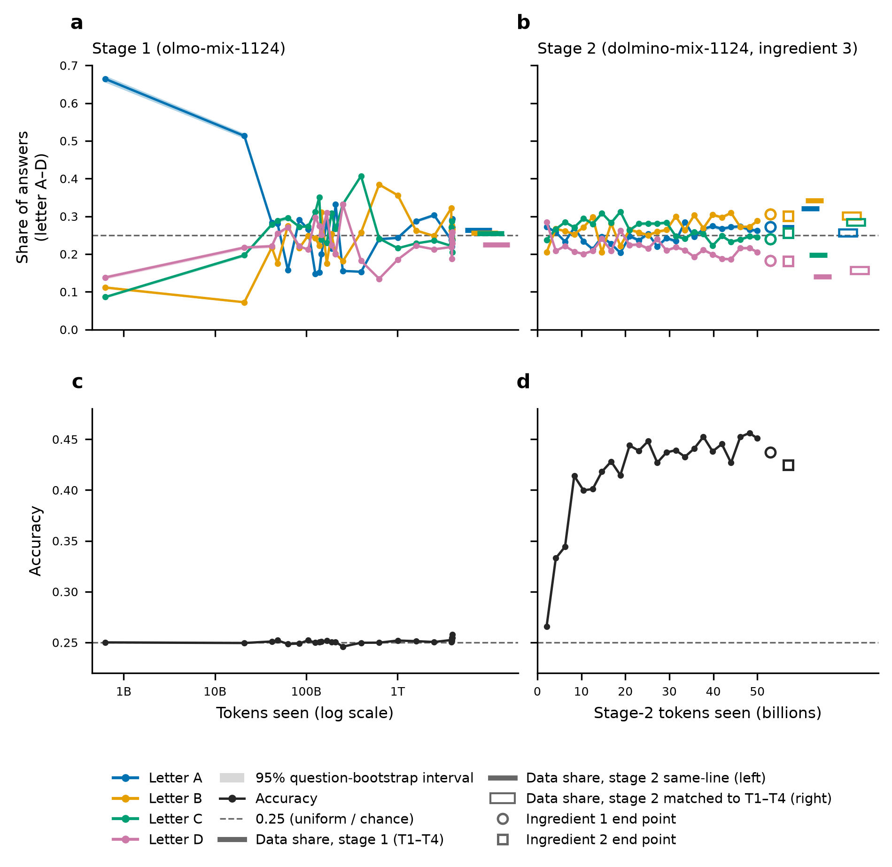

# When does OLMo 2 1B learn its answer-letter preference?

Letter bias across training checkpoints, compared with answer-letter counts in the training data.

Language models answering multiple-choice questions prefer some answer letters over others. A common explanation is that the preference reflects how often each letter appears as an answer in the training data. This repository tests that explanation on [OLMo 2 1B](https://huggingface.co/allenai/OLMo-2-0425-1B), whose intermediate checkpoints and training data are public.

The model's preference among A–D is measured at 53 checkpoints spanning pre-training (stage 1) and mid-training (stage 2). The change in preference at the switch between the stages is compared with the change in answer-letter shares in the data of each stage.

**Full report:** [`report/report.pdf`](report/report.pdf) (LaTeX source in [`report/`](report/)).



*Letter shares (top) and accuracy (bottom) across stage-1 (log scale) and stage-2 checkpoints; 500 ARC-Challenge questions, each shown in all 24 option orders, no prompt prefix. Bands are 95% question-bootstrap intervals. Right-margin markers are training-data letter shares.*

## Findings

1. **The pre-declared test says "did not match".** From the last stage-1 checkpoint to the last stage-2 checkpoint the letter shares change by A −0.80, B +2.14, C +3.99 and D −5.33 percentage points. The largest change is 5.33 pp on D (95% CI 4.88–5.80). Under every definition of an answer-letter occurrence in the data, this change does not align with the change in data shares well enough to meet the rule.

   | Stage-2 data definition | Data change A/B/C/D (pp) | Rank of 24 | β [95% CI] | Rank with EOS prefix | Verdict |
   |---|---|---|---|---|---|
   | Same-line (primary) | +5.7 / +8.6 / −5.8 / −8.5 | 8 | 0.17 [0.13, 0.21] | 12 | did not match |
   | Strict (as first locked) | +14.4 / +4.1 / −8.0 / −10.5 | 12 | 0.05 [0.02, 0.08] | 10 | did not match |
   | Matched to stage-1 strings | −0.7 / +4.6 / +3.0 / −6.8 | 2 | 0.76 [0.70, 0.82] | 5 | did not match |
   | Mix-weighted same-line | +4.5 / +7.1 / −4.5 / −7.0 | 8 | 0.22 [0.17, 0.27] | 12 | did not match |

   *Rank* is the rank of the observed alignment Σ Δm·Δd among the 24 label permutations; "matched" requires rank 1 and a positive β interval. *β* is the fraction of the data shift reproduced by the model.

2. **The result does not settle the question either way.** Letter shares vary with a standard deviation of 2.46–3.36 pp between neighbouring stage-1 checkpoints, about as much as the shift. With each of the last seven stage-1 checkpoints as baseline in turn, the rank ranges from 1 to 22 of 24. When seven checkpoints are averaged on each side of the switch, 2 of 4 definitions meet the rule without a prompt prefix and 0 of 4 with an EOS prefix. Four labels allow a minimum permutation p-value of only 1/24.
3. **Stage-1 checkpoints answer at chance in this format.** Accuracy is 0.246–0.258 at all 26 stage-1 checkpoints, while language-modelling loss falls normally and every checkpoint loads cleanly. In stage 2, accuracy rises from 0.266 at step 1,000 to 0.451.
4. **Letter D is consistently the least preferred letter at the end.** D has the lowest share at the end points of all three stage-2 runs under both prompt formats, and the lowest share in the stage-2 data under every definition.
5. **The prompt prefix matters.** Prepending an EOS token moves the final checkpoint's shares by up to 4.1 pp (letter C), as much as the bias itself.
6. **The released `main` weights are not on the published checkpoint lineage.** None of their 179 tensors equals the corresponding tensor of any stage-2 end point, the last stage-1 checkpoint, or their averages (relative L2 distance 1.51). Trajectory results do not apply to `main`.
7. **A naive count of answer keys is wrong.** A pattern that lets a newline separate `Answer:` from the label counts 74,523 `Answer:\n(A).` conversation-turn markers from a Flan template as option A. The primary definition requires the label on the same line.

## Method in brief

- **Checkpoints.** 26 stage-1 checkpoints (20 log-spaced in tokens, plus the 6 just before the switch), all 24 checkpoints of the released stage-2 run (ingredient 3), the end points of the two other stage-2 runs, and `main`.
- **Prompts.** 500 four-option ARC-Challenge test questions, zero-shot (`Question: … A. … B. … C. … D. … Answer:`), each in all 24 option orders; 26,009 prompts including blanked-option and digit-label controls.
- **Scoring.** Next-token probability of each label after `Answer:`, renormalised over the four labels; float32; scored with and without an EOS prefix. The digit labels ` 1`–` 4` are two tokens in the OLMo 2 tokenizer, so they are scored after an appended space token.
- **Stage-1 data.** Exact counts of `Answer: X`, `answer is X`, `answer is X.` and `Answer: (X)` (each ending a line) in the infini-gram index `v4_olmo-mix-1124_llama`.
- **Stage-2 data.** Regex scan of every Flan and math shard of `dolmino-mix-1124` (5,338 shards, 113.5 GB of text), plus seeded samples of the other subsets for a mix-weighted estimate.
- **Test.** Fixed before any model output on real prompts or any data count existed. Later amendments are listed, with what was known when each was made, in the report's appendix and in [`analysis/analysis_spec_locked.md`](analysis/analysis_spec_locked.md).

## Repository layout

| Path | Contents |
|---|---|
| `prompts/` | `build_prompts.py` (builds the prompt set from ARC-Challenge, seed 0), `prompts.jsonl`, `questions.csv` |
| `checkpoints/` | `checkpoint_manifest.csv` (all branches with stage, step, tokens seen and selection flags), `label_tokens.json` |
| `inference/` | `score_letters.py` (label log-probabilities), `score_health.py` (loading record and loss), `verify_unbatched.py`, Slurm wrappers and launchers, `assemble*.py`, `env_notes.md` |
| `data_counts/stage1/` | infini-gram query and context-sampling scripts, counts, sampled contexts, raw query log |
| `data_counts/stage2/` | dolmino scan and aggregation scripts, per-subset counts, sampled matches (v1 = first scan, v2 = rescan with separated patterns) |
| `analysis/` | `analyze.py` (produces every table in `results/`), the locked analysis specification, `inputs/` (assembled per-question tables) |
| `results/` | verdicts, robustness, per-checkpoint metrics, bootstrap intervals, data shares |
| `weights_identification/` | comparison of the released `main` weights with branch checkpoints |
| `figures/` | figures and `make_figure.py` |
| `report/` | LaTeX report, `make_tables.py` (generates every number and table in the report), compiled `report.pdf` |

## Reproducing

```bash
pip install -r requirements.txt

# 1. Prompts (downloads ARC-Challenge test from the Hugging Face hub)
cd prompts && python build_prompts.py && cd ..

# 2. Inference: one revision by hand ...
python inference/score_letters.py --revision stage1-step1907359-tokens4001B \
    --prompts prompts/prompts.jsonl --out out.parquet            # add --prepend-eos for the EOS series
#    ... or the whole sweep on a Slurm cluster: set OLMO_WORK, put the inference scripts, prompts.jsonl and
#    checkpoint_manifest.csv in the submit directory, then `sbatch launch_sweep.sh` (see inference/env_notes.md)

# 3. Training-data counts
python data_counts/stage1/stage1_query.py                        # infini-gram API
python data_counts/stage2/scan_dolmino_letters_v2.py --list WORK.jsonl --out OUT.jsonl --dl DL_DIR --procs 16
#    WORK.jsonl lists the shards to scan, one JSON object per line: {"subset", "path", "size"}

# 4. Analysis, figures and report numbers from the assembled tables
python analysis/analyze.py --inp analysis/inputs --out results
python figures/make_figure.py results/match_metrics.csv results/bootstrap_intervals.csv results/data_letter_shares.csv figures
python report/make_tables.py
```

Step 4 runs on a laptop in under a minute and reproduces the seven analysis tables in `results/` exactly. Steps 2–3 need a GPU (inference used one NVIDIA A30 per task: 15.88 GPU-hours for the sweep and 2.48 for the additional stage-1 checkpoints) and network access to the Hugging Face hub and the infini-gram API. The raw per-checkpoint scores and per-shard counts are not included; the assembled tables in `analysis/inputs/` are.

**Building the report:** `cd report && tectonic report.tex` (or `latexmk -pdf report.tex`) after running `python report/make_tables.py`.

## Limitations

- Stage-2 counts come from the public pool, not the exact 50B-token stage-2 sample.
- Data shares pool answer keys from questions with any number of options; the prompts have four.
- One benchmark, one prompt format, zero-shot.
- Bootstrap intervals resample questions only; variation between checkpoints is larger.
- Learning rate and data change together at the switch, so no change can be attributed to data alone.

## Data and models

- Model and checkpoints: [allenai/OLMo-2-0425-1B](https://huggingface.co/allenai/OLMo-2-0425-1B)
- Stage-2 data pool: [allenai/dolmino-mix-1124](https://huggingface.co/datasets/allenai/dolmino-mix-1124)
- Stage-1 counts: [infini-gram](https://infini-gram.io) index `v4_olmo-mix-1124_llama`
- Questions: [allenai/ai2_arc](https://huggingface.co/datasets/allenai/ai2_arc), ARC-Challenge test split

## Citation

See [`CITATION.cff`](CITATION.cff).

## Licence

Code is released under the [MIT licence](LICENSE). The report, figures and result tables are released under [CC BY 4.0](LICENSE-CC-BY-4.0.txt).
